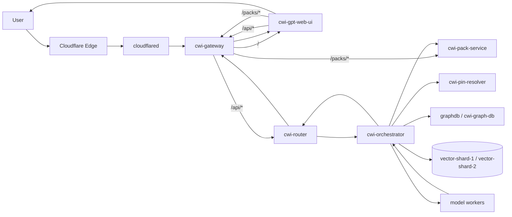

# Application Stack and Architecture

This document is the sole source of truth for the current CWI application
stack, runtime placement, and intelligence flow.

Legacy stack summaries, older flow diagrams, and historical alignment specs are
retained only as reference stubs or archival artifacts and should not be used
as competing architecture definitions.

Each component lists:
1. Description
2. Purpose
3. Feature list
4. Support functionality

## Current Runtime Placement

| Server name | VPN IP | Apps / services |
| --- | --- | --- |
| `public-gateway-01` | `100.124.140.66` | `cloudflared`, `cwi-gateway` (Caddy), `cwi-gpt-web-ui` |
| `internal-teacher-01` | `100.87.205.59` | `teacher-node`, `cwi-age-db` |
| `internal-mcp-01` | `100.120.208.51` | `cwi-router`, `cwi-orchestrator`, `cwi-coordination-layer`, `cwi-identity-server`, `cwi-pack-service`, `cwi-pin-resolver`, `cwi-teams-bot`, `cwi-consent-ingest`, `cwi-edge-agent`, `cwi-node-agent-runtime`, `redis`, `postgres`, `graphdb` |
| `vector-shard-1` | `100.115.118.16` | Qdrant vector shard |
| `vector-shard-2` | `100.91.142.103` | Qdrant vector shard |
| `gpu-worker-01` | `100.87.13.127` | GPU model workers and health/capabilities endpoints |
| `gpu-worker-02` | `100.90.161.26` | GPU model workers and health/capabilities endpoints |

## Intelligence Flow

This is the primary runtime intelligence path for user questions.

### Intelligence Flow Summary

1. The user reaches the public UI through Cloudflare edge and the `cloudflared` tunnel.
2. `cwi-gateway` serves the UI shell from `cwi-gpt-web-ui`.
3. The UI sends `/api/*` requests to `cwi-gateway`.
4. `cwi-gateway` forwards API traffic to `cwi-router` and pack traffic to
   `cwi-pack-service`.
5. `cwi-router` forwards ask workflows to `cwi-orchestrator`.
6. `cwi-orchestrator` retrieves pack, graph, and vector evidence as needed. In
   governed pack mode it resolves pinned pack artifacts through
   `cwi-pin-resolver`; otherwise it can read from `cwi-pack-service`
   directly. It then sends the grounded prompt to model workers.
7. The model response returns to `cwi-orchestrator`, then through
   `cwi-router`, `cwi-gateway`, and back to `cwi-gpt-web-ui`.

## Core Runtime Apps

**App Name: `cloudflared`**
Description: Cloudflare Tunnel connector running on the public gateway host.
Purpose: Provide the only public ingress path from Cloudflare edge into the gateway host in CGNAT-compatible deployments.
Feature List:
- Terminates the outbound tunnel connection to Cloudflare edge
- Publishes `cwigpt.com`, `www.cwigpt.com`, and `shield.cwigpt.com`
- Routes public hostnames to the gateway over HTTPS
Support Functionality:
- Forwards to `cwi-gateway` on `https://public-core-gateway:443`
- Uses origin TLS with verification disabled until the gateway certificate is replaced with a Cloudflare-trusted origin certificate
- Keeps direct host port exposure out of the public path

**App Name: `cwi-gateway`**
Description: Public ingress and reverse-proxy layer implemented with Caddy.
Purpose: Expose CWI APIs, pack routes, and telemetry endpoints to approved clients while shielding internal services.
Feature List:
- Routes `/api/*` traffic to the internal API plane
- Routes `/packs/*` traffic to pack-serving endpoints
- Supports public-to-internal request translation
- Acts as the public ingress boundary for browser and device traffic
Support Functionality:
- TLS termination and request routing
- Reverse proxy to `cwi-router` and `cwi-pack-service`
- Separation of public and internal network surfaces

**App Name: `cwi-gpt-web-ui`**
Description: Main end-user question-and-answer web client.
Purpose: Provide the primary user-facing interface for grounded pack-aware and graph-aware answers.
Feature List:
- User question entry
- Answer rendering
- Source rendering
- Confidence rendering
- Trace and evidence display
- Live request-journey display over SSE
- Pack-aware ask flow
Support Functionality:
- Calls `cwi-gateway` for `/api/*` and `/packs/*`
- Renders orchestrator output rather than performing reasoning locally
- Surfaces graph-aware trace metadata returned by the runtime
- Correlates live request-path events by `request_id`

**App Name: `cwi-router`**
Description: Internal API router for CWI service traffic.
Purpose: Centralize `/api/*` routing between ingress and the core internal services.
Feature List:
- Ask request routing
- Telemetry request routing
- Internal service dispatch
- Internal API boundary enforcement
- Request correlation propagation and journey event publication
Support Functionality:
- Fronts `cwi-orchestrator` and other internal services
- Keeps `cwi-gateway` thin and focused on ingress
- Provides a stable internal API entrypoint

**App Name: `cwi-orchestrator`**
Description: Core reasoning, retrieval, workflow, and pack-lifecycle engine.
Purpose: Execute grounded answering and orchestrate workflow paths across graph, vector, pack, and model systems.
Feature List:
- Ask workflow execution
- Graph query planning
- AGE graph evidence retrieval
- Vector retrieval coordination
- Prompt construction and evidence merge
- Pack lifecycle endpoints
- Trace, confidence, and reasoning receipt generation
- Durable request-journey persistence and live SSE streaming
Support Functionality:
- Queries `graphdb` and retained graph stores
- Queries vector shards
- Sends inference requests to model workers
- Emits provenance and audit signals
- Persists journey events in Postgres and fans out live updates from Redis

**App Name: `cwi-coordination-layer`**
Description: Coordination and control-plane service for agents and distributed runtime behaviors.
Purpose: Support enrollment, runtime coordination, metrics, and control endpoints.
Feature List:
- Coordination endpoints
- Enrollment support
- Runtime status handling
- Metrics and control-plane support
Support Functionality:
- Used by `cwi-node-agent-runtime`
- Supports edge and node coordination flows
- Provides a stable control endpoint for distributed runtimes

**App Name: `cwi-identity-server`**
Description: Identity and token service.
Purpose: Issue and validate identity tokens and back the platform auth model.
Feature List:
- OIDC/JWT issuance
- Auth and login support
- JWKS exposure
- Identity persistence integration
Support Functionality:
- Backs browser and admin auth flows
- Uses Postgres as identity persistence
- Supports internal service auth posture

**App Name: `cwi-pack-service`**
Description: Pack registry and artifact-serving service.
Purpose: Serve pack listings and pack artifacts over the `/packs` surface.
Feature List:
- Pack listing
- Static artifact serving
- Filesystem-backed pack access
- Pack artifact URL exposure
- Request-path event emission for pack resolution hops
Support Functionality:
- Reads mounted pack roots
- Serves the gateway, admin, and orchestrator flows
- Supports pack distribution and lifecycle consumption

**App Name: `cwi-pin-resolver`**
Description: Governed pack pin-resolution service for the MCP runtime.
Purpose: Verify signed pack pins, resolve the active approved pack hash, and
expose compatibility pack routes for governed pack consumption.
Feature List:
- Signed pin verification with Ed25519 raw public keys
- Priority-based pack hash resolution across `experiment`, `approved`, and
  `latest_stable`
- Compatibility routes for `latest` and versioned pack artifacts
- Ledger event emission for successful and denied resolution attempts
- Health and pack-resolution endpoints
Support Functionality:
- Reads mounted pin, pack, and key directories from the MCP host
- Supports orchestrator governed-pack access without embedding signature logic
- Bridges pack governance state to legacy-compatible `/packs/*` resolution

**App Name: `cwi-teams-bot`**
Description: Microsoft Teams integration service.
Purpose: Extend approvals and internal workflow interactions into Teams.
Feature List:
- Teams-facing interaction handling
- Approval workflow integration
- Internal API calls into the CWI stack
Support Functionality:
- Complements browser-based approval flows in Glassbox
- Uses Redis and Postgres-backed dependencies as configured
- Supports enterprise messaging integration

**App Name: `teacher-node`**
Description: Teacher-side operational service and CLI host.
Purpose: Own pack publication, validation, artifact generation, reporting, and teacher-side graph preparation workflows.
Feature List:
- Pack validation
- Anchor generation
- Publish and rollback flows
- Report generation
- Teacher HTTP service mode
- Graph tooling entrypoints
Support Functionality:
- Hosts thin wrappers over repo-native ETL graph tooling
- Writes teacher-side artifacts to filesystem-backed storage
- Supports operator- and CI-driven preparation workflows

**App Name: `cwi-consent-ingest` / `cwi-etl`**
Description: ETL and ingest execution layer for CWI document and consent processing.
Purpose: Parse, transform, normalize, and emit artifacts that feed ingest, graph, and provenance workflows.
Feature List:
- Document parsing and normalization
- Chunking and ingest support
- Provenance emission
- Graph projection support
- Consent ingest job execution
Support Functionality:
- Shared Python ETL package used across ingestion flows
- Deployed in the MCP bundle as `cwi-consent-ingest`
- Feeds downstream graph and document flows used by teacher and runtime components

**App Name: `cwi-connectors`**
Description: External workspace and enterprise integration runtime.
Purpose: Poll and synchronize source systems into the CWI platform boundary.
Feature List:
- Scheduled connector polling
- Connector-specific ingestion flows
- Local state and queue handling
- Retention metadata handling
Support Functionality:
- Bridges external systems to internal APIs
- Supports enterprise integration scenarios
- Optional by deployment phase, but deployment-ready in the repo

**App Name: `cwi-edge-agent`**
Description: Edge-side telemetry and buffered ingest runtime.
Purpose: Collect and forward device or site telemetry/signals into the CWI platform.
Feature List:
- Telemetry collection
- Buffered forwarding
- Survival signal emission
- Polling and looped runtime behavior
Support Functionality:
- Sends data to `cwi-gateway`
- Integrates with orchestration and control-plane flows
- Maintains local runtime state and buffering

**App Name: `cwi-node-agent-runtime`**
Description: Client-side node runtime for enrollment, health, and safety enforcement.
Purpose: Manage enrollment, activation, kill-switch handling, health, and task gating for distributed runtimes.
Feature List:
- Enrollment
- Activation and status handling
- Kill-switch enforcement
- Health endpoint exposure
- Periodic sync behavior
Support Functionality:
- Integrates with `cwi-coordination-layer`
- Supports operator and runtime safety controls
- Maintains local runtime state

## Admin and Operator Apps

**App Name: `cwi-glassbox-web-ui`**
Description: Browser-based operator and glassbox UI.
Purpose: Provide operator visibility into approvals, traces, runtime state, and governance controls.
Feature List:
- Approval inbox flows
- Trace visibility
- Kill-switch and operational views
- Audit-oriented UX
Support Functionality:
- Complements `cwi-teams-bot`
- Exposes operator-facing runtime transparency
- Supports browser-based approval completion

**App Name: `cwi-admin-console`**
Description: Administrative console for lifecycle and catalog operations.
Purpose: Manage pack lifecycle and admin actions from a dedicated browser surface.
Feature List:
- Pack catalog
- Upload and publish flows
- Activate and rollback flows
- Retire and delete flows
- Audit-oriented admin views
Support Functionality:
- Integrates with `cwi-identity-server`
- Calls `cwi-orchestrator` and `cwi-pack-service`
- Covers the administrative half of the browser UI story

**App Name: `cwi-identity-admin`**
Description: Identity-focused administrative UI.
Purpose: Support identity and auth administration tasks.
Feature List:
- Identity admin flows
- Auth configuration support
- Admin-facing control surface
Support Functionality:
- Complements `cwi-identity-server`
- Provides an admin adjunct rather than acting as a core runtime dependency

**App Name: `cwi-homepage-web-ui`**
Description: Public-facing homepage and entry UI.
Purpose: Provide a landing surface and public entry-point experience.
Feature List:
- Public-facing web experience
- Entry and navigation surface
Support Functionality:
- Adjunct public UI, not part of the core ask runtime path

## Graph, Retrieval, and Model Components

**App Name: `graphdb` / `cwi-graph-db`**
Description: Main Postgres + Apache AGE graph store on the MCP host.
Purpose: Persist graph projections used for GraphRAG retrieval and grounded runtime reasoning.
Feature List:
- Graph vertex and edge persistence
- AGE query support
- Graph retrieval backing for the orchestrator
Support Functionality:
- Receives graph artifacts from ETL flows
- Serves graph evidence to `cwi-orchestrator`
- Acts as the primary runtime graph source

**App Name: `cwi-age-db`**
Description: Separate teacher-host Apache AGE database.
Purpose: Support teacher-side graph build, staging, validation, and parallel graph workflows.
Feature List:
- Teacher-side graph ingest and query
- Staging and validation graph environment
Support Functionality:
- Supports `teacher-node` and ETL graph workflows
- Retained as a separate graph runtime on the teacher host

**App Name: `vector-shard-1` / `vector-shard-2`**
Description: Qdrant-based vector search infrastructure.
Purpose: Store and retrieve vectorized evidence for orchestrator retrieval.
Feature List:
- Vector indexing
- Similarity search
- Sharded retrieval
Support Functionality:
- Queried by `cwi-orchestrator`
- Supports document and evidence recall alongside graph retrieval

**App Name: `model workers`**
Description: GPU-backed inference endpoints.
Purpose: Execute model inference requests sent by the orchestrator.
Feature List:
- Model execution
- Health and capabilities endpoints
- GPU-backed serving
Support Functionality:
- Final model stage for answer generation
- Consumed by the orchestrator rather than exposed directly to end users

## Core Support Components

**App Name: `redis`**
Description: Cache and coordination store.
Purpose: Provide low-latency shared state, coordination, and transient data services.
Feature List:
- Caching
- Coordination primitives
- Shared transient state
Support Functionality:
- Used by router, bot, and related internal services
- Supports performance and runtime coordination needs

**App Name: `postgres`**
Description: Durable relational storage layer.
Purpose: Persist service-specific state, especially identity and other internal databases.
Feature List:
- Durable persistence
- Transactional relational storage
- Service database backing
Support Functionality:
- Supports `cwi-identity-server`
- Supports orchestrator and related service persistence where configured

**App Name: `teacher artifact store (filesystem-backed)`**
Description: Filesystem-backed artifact custody layer for teacher outputs.
Purpose: Hold teacher-side published packs, reports, graph artifacts, and related generated outputs.
Feature List:
- Artifact storage
- Published pack custody
- Teacher output retention
Support Functionality:
- Receives outputs from `teacher-node`
- Supports downstream pack-serving and mirror flows
- Replaces the need for teacher MinIO in the current target deployment model

**App Name: `observability stack`**
Description: Metrics, logs, and traces collection layer.
Purpose: Provide monitoring and diagnostic visibility across the platform.
Feature List:
- Metrics collection
- Logs and traces collection
- Dashboard and alert support
Support Functionality:
- Supports operations and troubleshooting
- Complements host-level agents like `cadvisor` and `node-exporter`

**App Name: `provenance ledger`**
Description: Audit and provenance recording target.
Purpose: Capture provenance and audit events from publication, reasoning, and teacher workflows.
Feature List:
- Provenance event recording
- Audit trace support
Support Functionality:
- Consumed by `teacher-node` and `cwi-orchestrator`
- Supports compliance, traceability, and reporting

## Teacher-Side Graph Tooling Layer

These components are implemented as repo-native ETL modules with teacher-node wrappers. They are tooling entrypoints, not separate deployable apps.

**App Name: `graph ontology and canonicalization tooling`**
Description: Canonical entity and relationship normalization layer.
Purpose: Produce deterministic graph vocabulary and shared IDs.
Feature List:
- Entity-type normalization
- Alias handling
- Canonical naming
- Deterministic ID generation
Support Functionality:
- Supports extraction, curation, crosswalk, and AGE artifact generation

**App Name: `entity and relationship extraction tooling`**
Description: Teacher-side graph extraction pipeline.
Purpose: Convert source documents into graph-ready entities and relationships.
Feature List:
- Per-document entity extraction
- Relationship extraction
- Provenance capture
- Confidence scoring
Support Functionality:
- Feeds rollup, curation, and cross-pack graph generation
- Provides deterministic graph preparation inputs

**App Name: `rollup, curation, crosswalk, and AGE artifact tooling`**
Description: Pack-level graph preparation and export layer.
Purpose: Produce curated graph artifacts and AGE-ready outputs for staging and runtime use.
Feature List:
- Pack rollups
- Graph curation
- Cross-pack inference edge generation
- AGE SQL and summary artifact generation
- Backfill support
Support Functionality:
- Feeds teacher-host graph workflows and runtime graph stores
- Supports graph build, validation, and release preparation
