# CWI Home Node Production Network Topology Spec

## Purpose

Define the production-ready network and application topology for CWI home nodes.

The production model is egress-only: customer home nodes initiate authenticated outbound connections to CWI. CWI services never initiate inbound connections into a customer's home network.

## 1. Production Network Topology

### Topology Principles

- Customer nodes must work behind normal NAT, CGNAT, and consumer routers.
- Customer routers must not require port forwarding, DMZ, UPnP, dynamic DNS, or inbound firewall rules.
- Customer nodes must not join a shared customer VPN or shared CWI development Tailnet.
- Every node must be bound to a tenant, owner user, node identity, device key, runtime mode, and revocation state.
- The public gateway is the only public CWI ingress boundary.
- Internal CWI services remain private behind the gateway/control-plane boundary.
- Raw home-node data stays local unless a user-approved policy explicitly allows export.

### Descriptive Flow Diagram

```mermaid
flowchart LR
  User[User Browser / Mobile App]
  DNS[Public DNS]
  CDN[Optional CDN / WAF / DDoS Protection]
  GW[CWI Public Gateway]
  Router[CWI Router]
  Identity[CWI Identity Server]
  Orchestrator[CWI Orchestrator]
  Coord[CWI Coordination Layer]
  Broker[Node Task Broker / Work Mailbox]
  Node[Customer Home Node]
  LocalData[Local Data / Memory / Models]
  Observability[Logs / Metrics / Audit / Receipts]

  User -->|HTTPS /api/ask| DNS
  DNS --> CDN
  CDN -->|HTTPS| GW
  GW -->|internal HTTP/gRPC| Router
  Router -->|JWT validation / policy context| Identity
  Router -->|request forwarding| Orchestrator
  Orchestrator -->|create node-bound task| Coord
  Coord --> Broker
  Node -->|outbound WSS/gRPC/HTTPS over mTLS| GW
  GW -->|node control endpoint| Coord
  Coord -->|deliver task over existing outbound channel| Node
  Node -->|local execution only| LocalData
  Node -->|result + privacy receipt + signature| Coord
  Coord -->|task status/result| Orchestrator
  Orchestrator -->|final response + trace| Router
  Router --> GW
  GW --> User
  GW --> Observability
  Router --> Observability
  Orchestrator --> Observability
  Coord --> Observability
  Node -->|redacted health/receipts only| Observability
```



### Hop-by-Hop Runtime Flow

1. The user authenticates through the public CWI site using HTTPS.
2. The public gateway terminates public TLS and routes API traffic inward.
3. The router validates auth context, tenant context, policy mode, and route intent.
4. The orchestrator decides whether the request needs the user's home node.
5. If the home node is required, the orchestrator creates a tenant-scoped node task in the coordination layer.
6. The coordination layer stores the task with lease, timeout, idempotency, and audit metadata.
7. The home node maintains an outbound authenticated channel to CWI.
8. The coordination layer delivers the task to that node over the node-initiated channel.
9. The node executes locally against local data, local memory, local packs, and optional local model.
10. The node returns a signed task result with privacy receipt and redacted trace.
11. The orchestrator merges the node result into the normal CWI response path.
12. The user receives the answer through the gateway.

### Required Runtime Modes

```text
CWI_NODE_RUNTIME_MODE=dev_tailnet | beta_egress_only | prod_egress_only
```

- `dev_tailnet`: internal lab only. May use Tailnet addresses for development.
- `beta_egress_only`: first shipped beta mode. No Tailscale dependency. No inbound ports.
- `prod_egress_only`: production mode. Same as beta, plus stricter firewall, revocation, signed update, cert rotation, and telemetry controls.

### Production Fail Conditions

Do not ship if any of these are true:

- The home node requires a `100.x` Tailnet address to function.
- The home node requires inbound ports.
- The home node advertises LAN subnet routes.
- One customer node can reach another customer node.
- CWI can directly connect into the home node without a node-initiated channel.
- Raw local data leaves the node without explicit approved export policy.
- Revoked nodes can reconnect.
- Duplicate task submission causes duplicate execution or duplicate ledger state.

## 2. Required Network Pieces And Hardware

### Customer Site Hardware

- CWI home-node appliance or approved mini PC.
- CPU sized for local indexing, task handling, and optional small local model.
- RAM sized for local memory, local packs, and local model profile.
- Encrypted local SSD/NVMe storage.
- Optional GPU/NPU if local inference is part of the shipped tier.
- TPM or secure element preferred for device identity/private-key protection.
- Ethernet preferred; Wi-Fi optional.
- UPS optional but recommended for reliability.

### Customer Network Requirements

- Standard home internet connection.
- Outbound HTTPS/WSS access to CWI endpoints on TCP 443.
- DNS resolution.
- NTP/time sync.
- No router port forwarding.
- No inbound firewall openings.
- No shared VPN requirement.

### CWI Cloud / Data Center Network Pieces

- Public DNS for CWI app and node control endpoints.
- Public TLS certificates.
- Optional CDN/WAF/DDoS layer.
- Public gateway/load balancer.
- Private service network for router, orchestrator, coordination, identity, pack service, databases, graph, vector, and model workers.
- Firewall/security groups separating public ingress from internal service traffic.
- Private database network.
- Observability network path for logs, metrics, traces, and audit receipts.
- Backup and disaster recovery storage.

### Security And Connectivity Infrastructure

- Certificate authority or managed PKI for node/client certificates.
- Device enrollment trust store.
- Certificate revocation list or online revocation endpoint.
- Signed update infrastructure.
- Secrets manager for tokens, signing keys, and cert material.
- Network egress allowlist for home node outbound traffic.
- Per-tenant isolation rules in the control plane and application layer.

## 3. Required Software Components

### Home Node Software

- `cwi-node-agent-runtime`
  - Runtime-mode enforcement.
  - First-boot enrollment.
  - Local keypair generation.
  - Outbound mTLS control channel.
  - Heartbeats and capability reports.
  - Local task execution.
  - Local queue/WAL for offline/reconnect.
  - Privacy receipt generation.
  - Redacted logs.
  - Kill-switch/revocation handling.
  - Connectivity proof command.
  - Signed update validation.

- Local data services
  - Local memory store.
  - Local pack cache.
  - Local embeddings/vector index if enabled.
  - Optional local model runtime.

- Local security services
  - Disk encryption.
  - Key storage or TPM-backed secret handling.
  - Local-only diagnostics endpoint bound to `127.0.0.1` by default.
  - Firewall profile denying inbound access by default.

### CWI Control Plane Software

- Public gateway
  - Public TLS termination.
  - Gateway routing for `/api/*`, auth, and node control endpoints.
  - Rate limits and request-size limits.

- Router
  - Auth-aware request routing.
  - Tenant isolation.
  - Policy-mode forwarding.

- Identity server
  - User authentication.
  - Tenant/user identity.
  - Pairing authorization.
  - JWT/JWKS.

- Orchestrator
  - Determines whether a request needs home-node execution.
  - Creates node-bound tasks.
  - Handles node offline/degraded/timeout states.
  - Merges node results into final answers.
  - Preserves provenance and privacy receipt metadata.

- Coordination layer
  - Node enrollment API.
  - Node registry.
  - mTLS/client identity validation.
  - Heartbeat and last-seen tracking.
  - Work mailbox/task broker.
  - Task lease/ack/result handling.
  - Idempotency and duplicate-safe result submission.
  - Revocation and kill-switch propagation.
  - Audit/provenance event emission.

### Contracts And Tests

Required contracts:

- Node enrollment request/response.
- Node heartbeat.
- Node task.
- Node task result.
- Node connectivity proof.
- Privacy receipt.

Required tests:

- Beta node enrolls without Tailscale.
- Node behind NAT receives task over outbound-only connection.
- No peer-node reachability between two simulated customer nodes.
- Revoked node cannot reconnect.
- Duplicate task result is idempotent.
- Offline queue and reconnect are safe.
- Raw data export is blocked by default.
- Runtime mode rejects Tailnet-required beta/prod config.
- Orchestrator cannot route one user's request to another user's node.

## Current Gap Summary

The repo has important foundation already: node-agent runtime, outbound control channel, coordination work mailbox, orchestrator dispatch, QR linking, node IDs, and local execution hooks.

The remaining production-readiness gap is enforcement and productization:

- Runtime modes are not yet enforced.
- Existing deployment configs still contain Tailnet `100.x` assumptions.
- Node coordination endpoints need to be gateway-routed public `https/wss` endpoints.
- Enrollment needs product-grade pairing, cert/token issuance, rotation, and revocation.
- Privacy receipts and connectivity proofs need to become first-class contracts.
- Gold tests need to prove the egress-only, no-shared-VPN topology.
